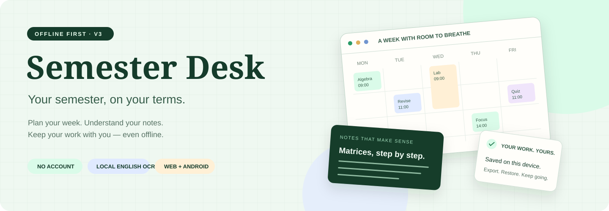
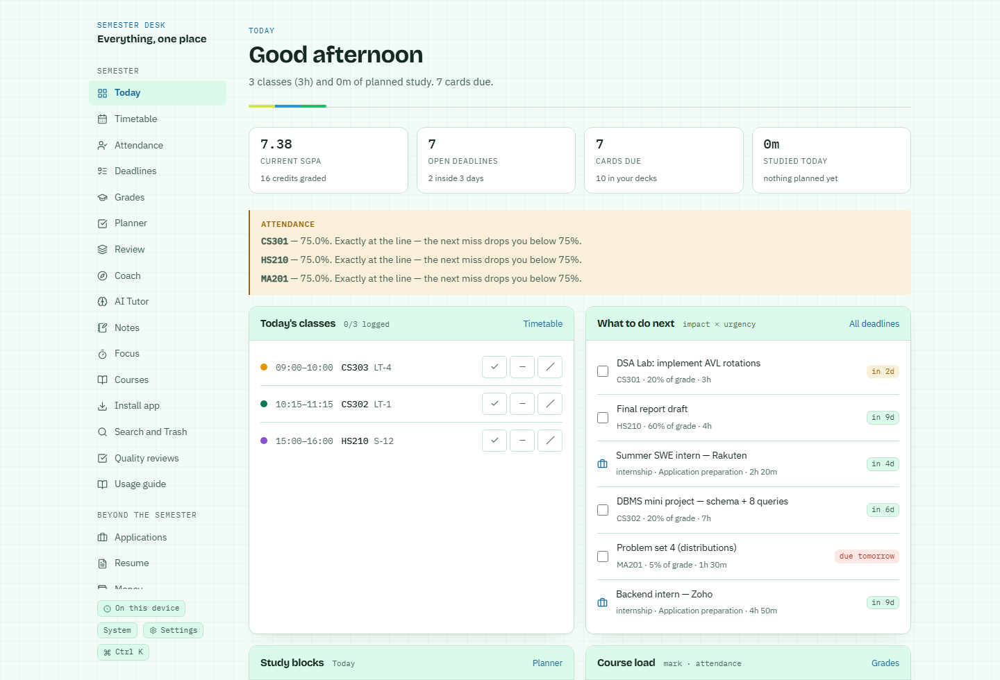
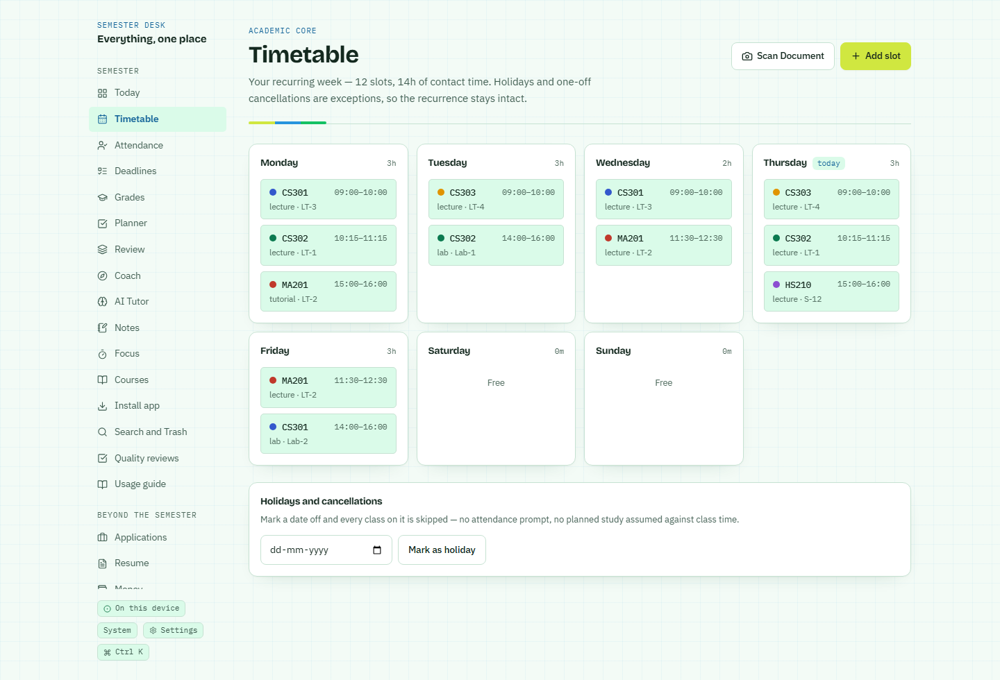
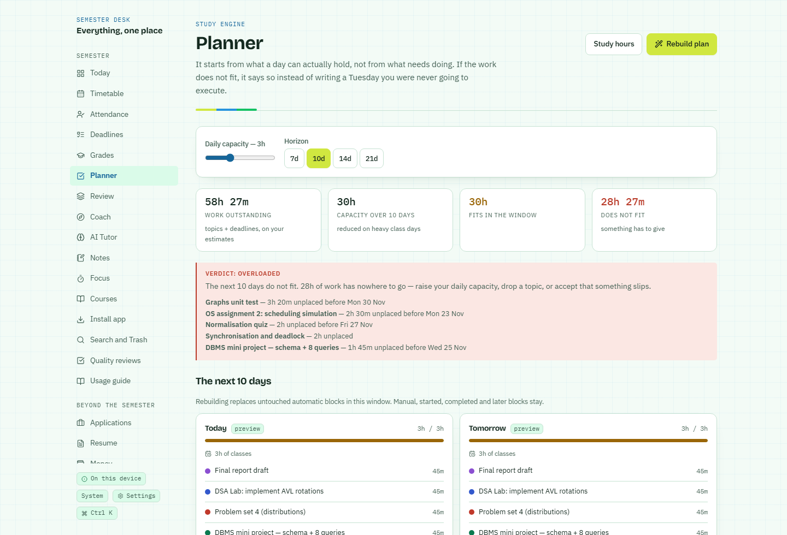

<p align="center"></p>

<p align="center"><a href="https://playxgaming.github.io/semester-desk-offline/"><strong>Open the app ↗</strong></a> · <a href="https://github.com/playxgaming/semester-desk-offline/releases/latest"><strong>Download Android ↗</strong></a> · <a href="docs/USER_GUIDE.md"><strong>Full usage guide</strong></a></p>

<p align="center"><a href="https://github.com/playxgaming/semester-desk-offline/actions/workflows/release.yml"></a>    </p>

**One local workspace for classes, notes, revision, planning and student life.** Semester Desk is an offline-first React PWA and signed Android sideload app. Your study data and files live on your device. No account, remote database or background sync is required.

AI is optional. Local English OCR, flashcards, quizzes, calculations and planning work without a model. Connected AI sends only explicitly selected requests and context through your chosen connection.

## A quick look



<table>
<tr><td width="50%"><p align="center">A week you can see clearly</p></td><td width="50%"><p align="center">Notes you can edit and verify</p></td></tr>
<tr><td><p align="center">Study time that respects your calendar</p></td><td><p align="center">Evidence of what you checked</p></td></tr>
</table>

Screenshots show a disposable demo profile, not real student records or live AI output. [Full illustrated guide →](docs/USER_GUIDE.md)

## What is included

| Workspace | Tools |
| --- | --- |
| **Academic** | Courses, semesters, weekly/alternating classes, exceptions, attendance, deadlines/subtasks, weighted grades and GPA. |
| **Sources** | Reviewed syllabus/reference imports, text PDFs, original files, cropped/rotated photo and scanned-PDF English OCR, timetable conflict checks and optional image AI. |
| **Learning** | Markdown/LaTeX notes, local drafts/history, source-linked AI drafts, editable flashcards, spaced repetition, saved quizzes, mistakes and approved revision work. |
| **Planning** | Daily capacity or timed study windows, class/deadline-aware previews, protected atomic saves, catch-up, overload reporting, recoverable Focus and deterministic Coach. |
| **Quality** | Manual accuracy/coverage/readability/source checks, exact reviewed snapshots, changed-content flags and pilot reports. |
| **Career & life** | Applications/contacts, CV variants and frozen submission snapshots, expenses, budgets, anchored recurring bills and habits. |
| **Ownership** | Full-content Search/Trash, portable JSON backups with original files and hashes, conflict-previewed imports and CSV records. |
| **Everywhere** | Responsive PWA, signed Android APK, bundled offline OCR, native reminders and an offline usage guide. |

## Start using it

1. **[Open the website](https://playxgaming.github.io/semester-desk-offline/)** or **[download the Android APK](https://github.com/playxgaming/semester-desk-offline/releases/latest/download/semester-desk.apk)**.
2. Complete setup or explore the demo. Use **Settings → Reset and start empty** when ready for your own records; export anything you want to retain first.
3. Add courses, check your imported timetable/syllabus, then add upcoming deadlines.
4. Preview and save a Planner schedule. Turn notes into reviewed cards and Coach quizzes.
5. Export a complete JSON backup outside browser storage.

Let the website cache its assets once; **Install app** shows readiness. The APK bundles offline assets. Install the PWA from Chrome/Edge, or Safari → Share → Add to Home Screen on iPhone/iPad. On phones, **More** reveals all tools.

> **Moving from the old site or APK?** Export a complete JSON backup there, import here and check it. A new website path has separate storage. Replacing an old debug-signed APK may require reinstalling, which deletes app data. [Migration and installation →](ANDROID.md)

## Run locally

Use **Node.js 22.13+**. No account or API key is needed for the core app.

```bash
npm ci
npm run dev
```

For the production build:

```bash
npm run build
npm run preview
```

The first launch seeds a worked demo semester. Reset deliberately when ready to enter your own data. Back up before resetting, reinstalling or clearing site storage.

## Optional AI

| Connection | Where | Capabilities |
| --- | --- | --- |
| None | Web, PWA, Android | All local tools, English OCR, Coach, cards and quizzes. |
| Windows ChatGPT connector | Its local app window | Interactive plan sign-in, text Tutor and source-linked notes. |
| Your Gemini backend | Website / APK with HTTPS backend configured | Text Tutor, source-linked notes and image extraction. |
| Your Groq backend | Website / APK with HTTPS backend configured | Alternative text Tutor and source-linked notes. |

[ChatGPT guide](CHATGPT_CONNECTION.md) · [AI/backend setup](AI_SETUP.md) · [Pilot setup](PILOT_SETUP.md)

GitHub Pages serves the frontend, not the optional Node server. A ChatGPT subscription is not an API key for the website/APK. Provider keys stay on your backend. Free tiers, models and quotas may change; no unlimited inference is bundled. Review AI facts and equations against your course material.

## Verify and release

```bash
npm ci --prefix server
npx playwright install chromium
npm run verify                 # build + all release regression groups
npm run verify -- --core        # build + data/calculation/contract checks
npm run docs:screenshots        # fresh demo screenshots; preview on 4173
npm run android:release         # JDK 17, SDK 34 + private signing environment
```

The release workflow gates **website deployment and signed APK publishing** on the same verification. Android uses the exact verified web assets, an increasing version code and stable private signer. Releases include checksums, package/signature evidence and the complete source ZIP.

[Testing](docs/TESTING.md) · [Deployment and rollback](DEPLOYMENT.md) · [Android builds](ANDROID.md) · [Changelog](CHANGELOG.md) · [Architecture](docs/ARCHITECTURE.md)

AI tests use synthetic providers and do not certify factual accuracy. Browser tests do not prove physical Android install/upgrade, closed-app alarms or low-memory OCR behaviour. This is an Android sideload release, not a Play Store listing. [Manual acceptance →](PILOT_ACCEPTANCE.md)

## Project map

```text
src/routes/           Student tools and offline guide
src/components/       UI, imports, provider connections and review workflows
src/db/               Local schema, atomic writes, files and recovery
src/lib/              Calculations, planning, OCR/PDF, backups and providers
server/               Optional AI proxy; provider keys stay on the server
scripts/              Verification, browser checks and Windows connector
android/              Capacitor wrapper and signing integration
docs/                 Illustrated guide, screenshots, testing and architecture
.github/workflows/    Verified website and signed APK publishing
```

React · TypeScript · Vite · Tailwind · Dexie · Capacitor · KaTeX · PDF.js · Tesseract.js. Upstream dependencies retain their respective licences; generated offline assets retain upstream notices.

## Help and contributions

[Usage guide](docs/USER_GUIDE.md) · [Troubleshooting](docs/USER_GUIDE.md#troubleshooting) · [Contributing](CONTRIBUTING.md) · [Security](SECURITY.md)

Report the visible version, affected tool, steps and a minimal synthetic example. Remove personal data, provider credentials and sign-in material from reports and screenshots.
