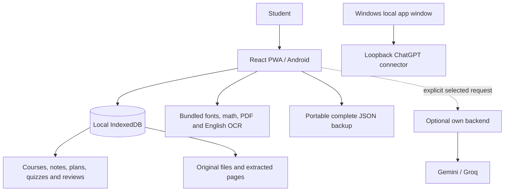

# Architecture

React/TypeScript frontend, Dexie IndexedDB, Vite PWA precaching and a Capacitor Android shell. Core tools do not require an account, remote database or background sync. Optional AI services are separate.

Database v6 contains 32 entity tables plus local blobs. Typed mutations stamp timestamps and announce changes after transaction completion. Soft deletes enable recovery. Related changes—imports, plan replacement, application stages/snapshots and quiz revision sessions—commit atomically.

Browser storage is origin-scoped, not path-scoped. Both GitHub Pages repository paths on `https://playxgaming.github.io` use database `semester-desk` and share data/preferences within one browser profile. The v2-to-v6 migration is additive, but users should back up before upgrading and avoid using an older build against the upgraded database. Separate browser profiles or origins isolate pilots; local connector/dev ports and Android are separate installations.

Note drafts are separate from published history. Generated notes preserve source excerpts/provider/model and structurally checked quotations. Quality reviews retain exact content/context; changes invalidate the current verdict while preserving prior snapshots.

Portable backup v3 carries attachment bytes, sizes and SHA-256 hashes. Import validates before writes, previews conflicts and commits atomically. Record-only v2 imports remain supported, with missing-file limits reported. CSV excludes bytes.

Attendance, GPA, spending, repetition, quizzes, Coach and scheduling are deterministic local logic. Timed planning respects classes, fixed work, teaching weeks and exact deadlines, and reports shortfall. Import/AI proposals require student review before writes.

The optional server validates requests/uploads, applies bounded rate/concurrency rules and holds provider keys. It supports a controlled pilot; unrestricted shared paid hosting needs authentication and durable per-user quotas. CORS is not authentication. The Windows connector binds loopback, checks origin/CSRF and returns only whitelisted session fields. Hosted pages/APKs cannot silently reuse it.

Relative Vite assets support both GitHub Pages project paths and Android. PWA precaching includes fonts/PDF/OCR; initial offline assets are roughly 21 MB, varying with dependencies. Android bundles the same assets and skips PWA registration. VersionName follows package.json; versionCode increases per CI run. Private signing material stays outside source and in encrypted GitHub secrets.
