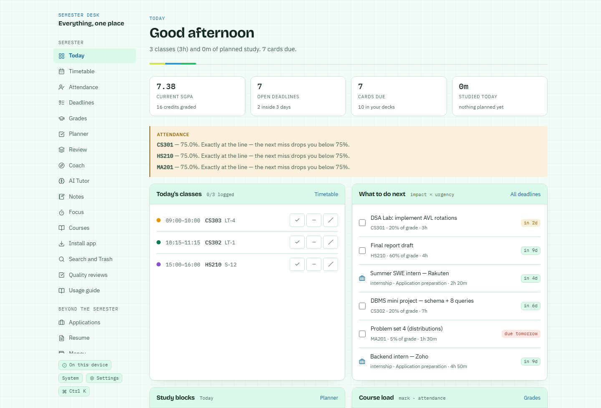
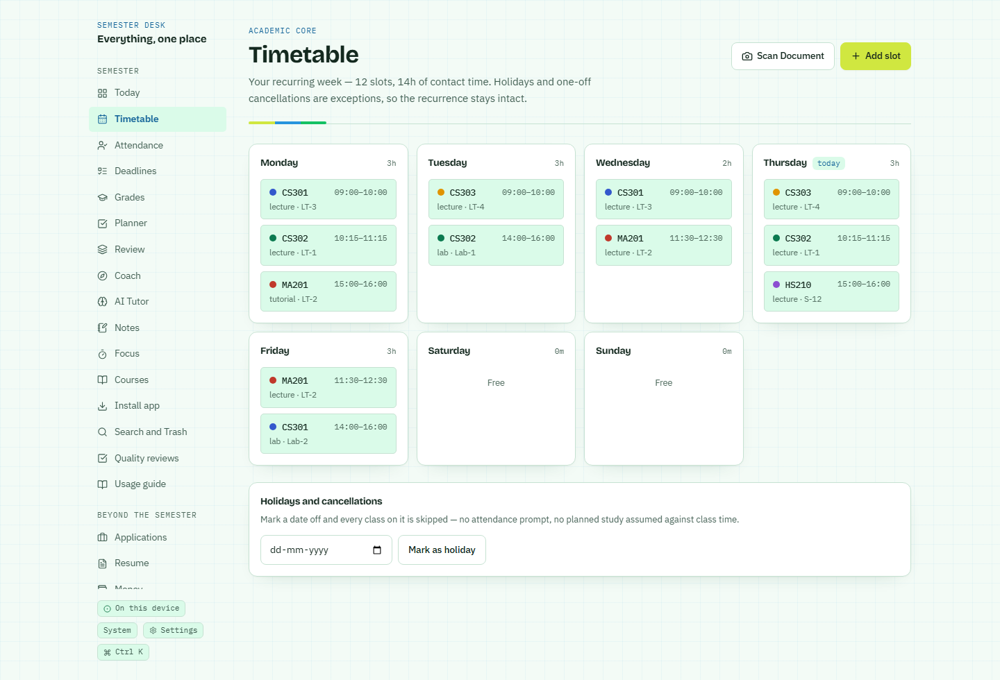
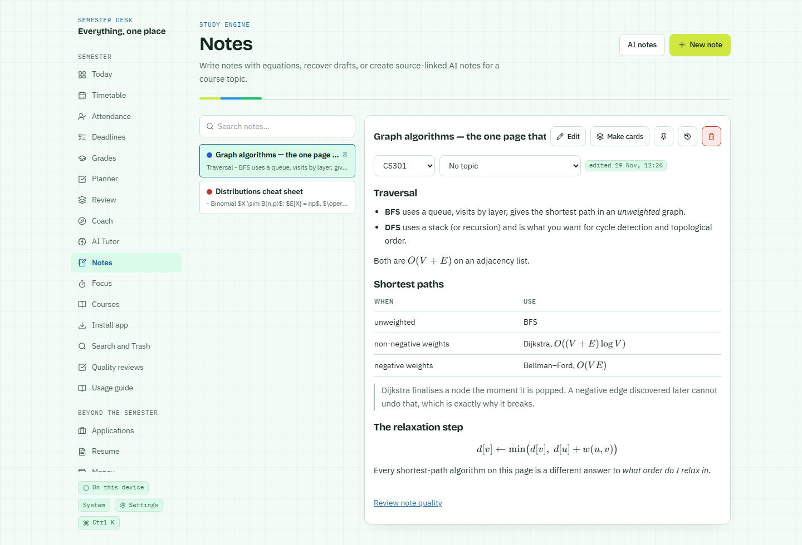
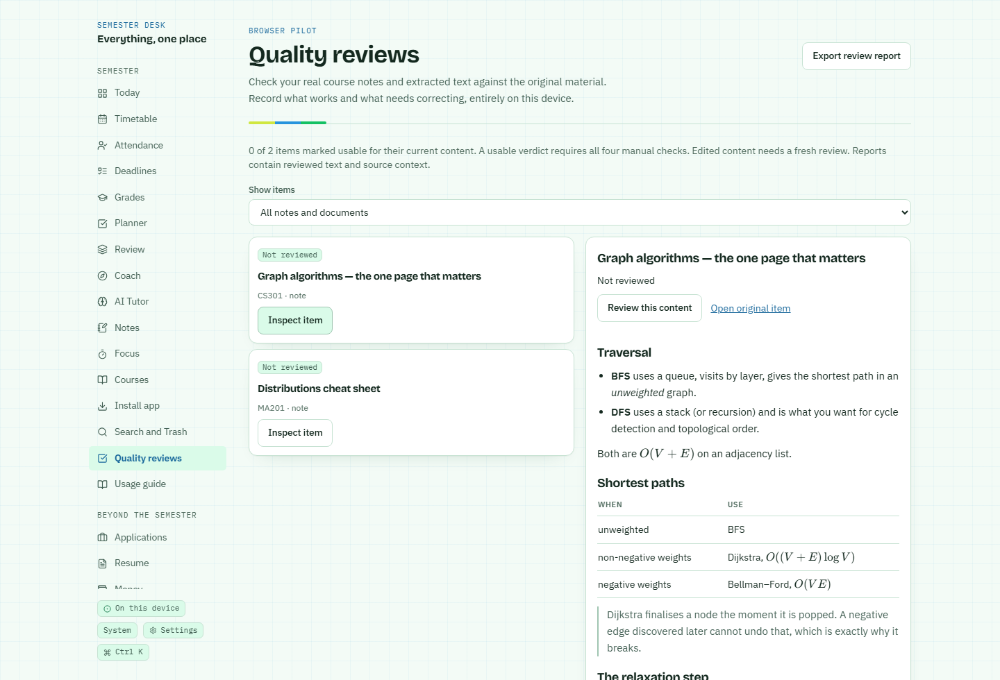
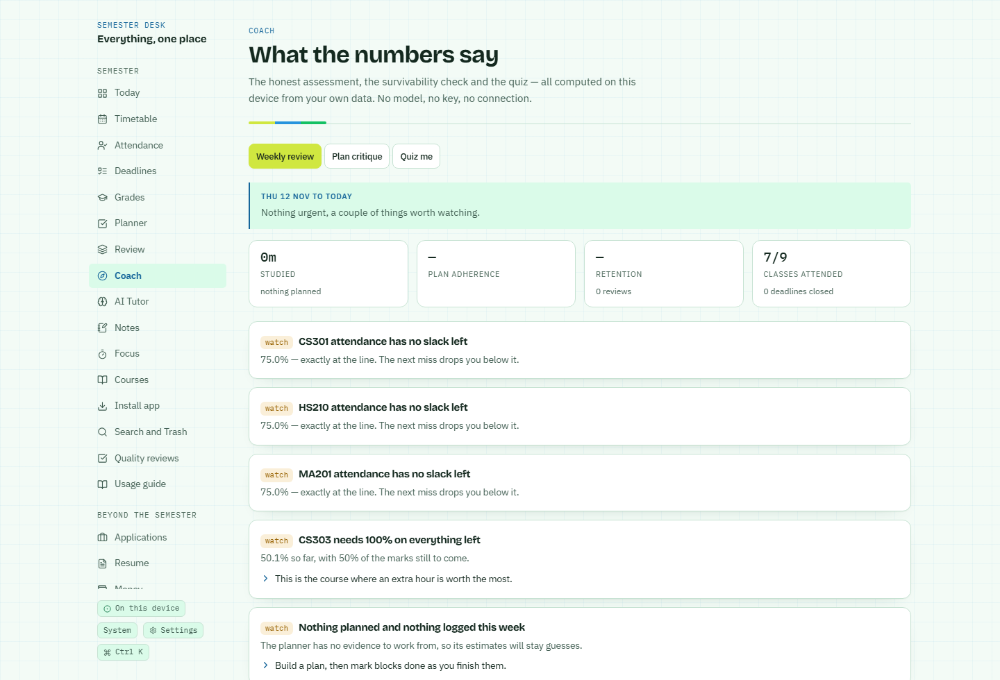
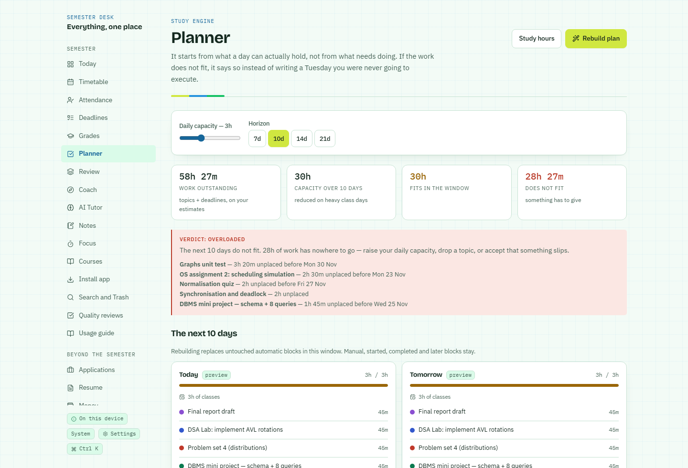
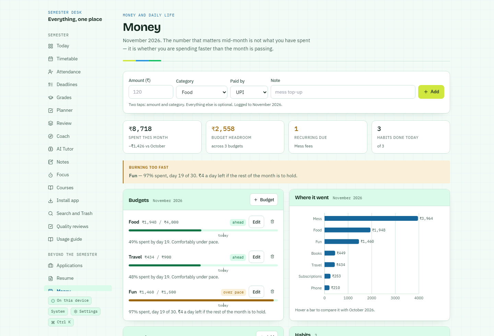

# Your complete Semester Desk guide

[Open the app](https://playxgaming.github.io/semester-desk-offline/) · [Download Android](https://github.com/playxgaming/semester-desk-offline/releases/latest) · [Back to the README](../README.md)

Semester Desk keeps a semester's study, career and daily-life records on your device. The website and Android app share the same tools, but each installation has its own local data. No account or database service is needed. Optional AI is a separate connection.

All screenshots below show the built-in demo semester in a disposable browser profile.

## Start in ten minutes

1. Open the website or install the signed APK. Let the website finish caching before disconnecting.
2. Complete the setup wizard, or explore the clearly labelled demo first. To use your own data, use **Settings → Reset and start empty**, then add your profile and courses. Export any work you want to keep before resetting.
3. Set your term dates, current semester, grading scheme, daily study capacity and attendance target in Settings.
4. Add courses, then import or enter your timetable and syllabus.
5. Add your next assignment and exam deadlines with accurate due times and effort estimates.
6. Preview a Planner schedule, check it and save it. Start small; overload is a signal to revise the work, not an instruction to study longer than you can.
7. Export your first complete JSON backup in Settings.

On a phone, **More** opens the rest of the tools. The search/command button opens navigation shortcuts. **Usage guide** is available inside the app even offline.

## Today: know what to do next



Today brings together the current day's classes, attendance prompts, deadlines, study blocks and useful next actions. Academic percentages describe academic work; career deadlines are ranked separately. Open a listed item to change the underlying record. Check your device timezone before entering deadlines; dates and alarms follow the device clock.

## Courses, syllabus and source material

Add a course code, name, credits, instructor, colour, semester, target grade and attendance requirement. Archive an old course to keep its records while removing its work from active study planning.

In a course, **Import syllabus** accepts pasted text, selectable-text PDFs and local English photo/scanned-PDF OCR. Review the extracted text, preview topics, correct names/units/effort estimates, and approve the import. Existing equivalent topics are skipped. Estimates are planning estimates, not official teaching hours. Import Undo protects unrelated later work.

Use **Add reference material** for lecture notes or teaching content. A syllabus often names topics without explaining them; include reference material before expecting detailed AI notes. Originals, extracted pages and reviewed text are saved locally. Open a saved source to search extracted pages, download its original file or review its extraction quality.

Local recognition supports printed English, up to 25 MB per file and up to ten scanned PDF pages per OCR job. Selectable-text PDF extraction supports up to 80 pages. Crop and rotate a clear image first. Check symbols, negative signs, tables and reading order carefully. Handwriting and complex grids may need manual correction.

## Timetable and holidays



Enter a class's course, weekday, start/end, room and lecture/lab/tutorial type. Record a one-off cancellation, holiday, move or extra class as an exception; keep the underlying weekly recurrence.

For a photograph, choose **Scan Document**. Local OCR requires no provider. Its automatic timetable proposals expect explicit lines such as `Mon 09:00-10:00 MATH101`; arbitrary grid layouts must be reviewed into rows. Optional image AI can propose grid rows when a Gemini backend is configured.

Review course-code legends, ambiguous matches, sections, kind, times, duplicates and highlighted overlaps. For alternating classes, choose Week A/B and the Week A anchor date. Preview both weeks before importing. Nothing is saved until you approve. An identical reimport should not create a second class.

Public-holiday import in Settings requires internet and confirmation. Check local academic holidays yourself; a public calendar cannot know your institution's timetable.

## Attendance

Mark each scheduled class present, absent, cancelled or excused. Correct mistakes from Attendance. Cancelled classes are excluded from held-class calculations. The app shows current attendance, how many additional classes you can miss and how many consecutive classes you need to recover to your course's target. These are calculations from recorded data, so record historical classes accurately.

## Deadlines, subtasks and grades

Add assignments, quizzes, exams, projects, reading or administrative tasks. Include the exact due date/time, course, grade weight where applicable, effort estimate, notes, subtasks and attached instructions. Update progress as work changes. Priority considers impact, urgency and effort; it does not replace your judgement.

In Grades, enter each assessment's weight, maximum mark and score. Leave an unknown score ungraded. Review the total weight before trusting a target calculation. The required-score calculator distinguishes already achieved, reachable and impossible targets. GPA uses credit weighting and your editable grade bands; check that they match your institution.

## Notes, equations, drafts and history



Create a note and link it to a course/topic. **Edit** opens the editor; **Preview** renders it. Basic syntax:

```markdown
# Matrices
**Definition:** a rectangular arrangement of numbers.
Inline equation: $A_{ij}$
Display equation: $$A=\begin{pmatrix}1&2\\3&4\end{pmatrix}$$
```

The renderer also accepts `\(...\)` and `\[...\]` math delimiters. Code stays literal. Draft edits are stored locally; **Save** publishes the note and keeps prior content in History when a snapshot is needed. `Ctrl/Cmd+S` saves, and `Ctrl/Cmd+E` toggles Edit/Preview. History restores an earlier version while retaining what it replaced. Search includes drafts.

### Optional source-linked AI notes

Choose **AI notes**, then the course/topic, provider, style, level and excerpts to share. Review exactly what will be sent. Generation creates a separate editable draft, preserving existing notes. Regeneration uses **Generate another draft**. If saving fails after generation, retry saving rather than spending another model request.

Source markers and quotations are structurally checked, and saved provenance is available offline. This does **not** establish factual accuracy. Check explanations, equations, examples and missing topics against your original material.

## Quality reviews



Open **Quality reviews**, **Review note quality**, or **Review extraction quality**. Inspect the current saved content and compare it with your original material. Record accuracy, coverage, readability and source checks. Usable requires four manual passes; Needs changes and Rejected require a specific issue.

Each review retains its exact title, body and source context. Edits flag **Changed since review**. Pinning a note does not invalidate it. Add a fresh review after a correction; previous reviews remain visible. A form opened before a concurrent content change cannot save an outdated verdict.

**Export review report** downloads readable pilot evidence, including reviewed text and context. Choose deliberately before sharing it. Use a complete app backup, rather than this report, to restore your app.

## Flashcards, review and quizzes

In Notes choose **Make cards**. Edit proposed questions/answers and approve only useful cards. The local extractor recognises definitions, tables and labelled formulas; it is not a model and may miss ordinary prose.

Review due cards with Again, Hard, Good or Easy. Reveal before grading. Bury moves a card to tomorrow; suspend removes it from active review until you restore it. On a keyboard, Space reveals, 1–4 grade, `-` buries, `!` suspends and Escape exits.

Coach offers a weekly review, plan critique and card-based quizzes. Quizzes save answers and position, so you can reload and resume. Review mistakes after finishing and explicitly approve revision sessions for a chosen day. A small deck without enough distinct answers uses recall rather than ambiguous multiple-choice options.



## Planner, catch-up and Focus



Set daily capacity in Settings, or use **Planner → Study hours** for timed weekly availability windows. Timed planning avoids classes and fixed blocks, respects teaching weeks and ends task work before the exact deadline. With no study windows configured, the capacity-based mode allocates daily minutes. Untimed existing blocks reserve minutes but have no known exact position.

Preview before saving. Manual, started and completed work is protected; a stale preview cannot replace newer conflicting work. The planner reports shortfall when demand exceeds availability. Catch-up moves missed work into remaining capacity without moving it past its deadline. Review and confirm its proposals.

Focus uses a wall-clock timer and saves running or paused state. Select the relevant work, start, pause/resume and complete the session. Logged time is credited atomically, so a retry does not double-credit a study block. Reset intentionally discards the current timer.

## AI Tutor and provider connections

Tutor supports Explain, Hint and Practice, saved conversations, follow-ups, Stop and saving useful output to Notes. Choose the provider explicitly. An unavailable provider does not silently switch an existing conversation.

| Connection | What it enables | What you supply |
| --- | --- | --- |
| None | All core tracking, local OCR, cards, quizzes, deterministic Coach and backups | Nothing |
| Windows local ChatGPT connector | ChatGPT plan text tutoring and source-linked note drafts in its local app window | Your own interactive sign-in; see [ChatGPT setup](../CHATGPT_CONNECTION.md) |
| Optional Gemini server | Text tutoring, source-linked notes and image-AI extraction | A server-side provider key and reachable backend |
| Optional Groq server | Alternative text tutoring and source-linked notes | A server-side provider key and reachable backend |

The hosted site and APK do not reuse a ChatGPT subscription login directly. The Windows connector has its own local origin and private credential storage. Never paste session cookies or API keys into an app URL, a GitHub issue or a chat. See [AI setup](../AI_SETUP.md); free tiers and model availability can change. Model/network/quota errors leave manual/local tools available. No paid or unlimited inference is included.

## Applications, contacts and resume

Track organisations, roles, deadlines, stages, SOP/LOR progress, links and contacts. Stage changes and timeline events save together. Once an application moves beyond Sourced with a linked resume, it retains an immutable CV snapshot including contact details. Later resume edits do not rewrite that recorded submission. A legacy application only captures its then-current CV on its next save; it cannot reconstruct an earlier submission.

Build structured resume items and variants. Add email, phone and website in Settings. Export Markdown/DOCX or print, and proofread the generated document. Variants remain editable; submission snapshots are the historical record.

## Expenses, budgets, recurring payments and habits



Record expenses with amount, category, payment method and date. Budgets compare category spending with the elapsed part of the month. Recurring bills retain their category/method and anchored monthly date; paying a January 31 bill should not permanently move later payments to February's last numbered day. Review the actual payment amount/date when recording it.

Habits provide a daily checklist, streaks and history. A streak reflects recorded behaviour, not an external measure of study quality. Correct records carefully and use Undo/Trash where available.

## Search, Trash, attachments and complete backups

Search and Trash searches full local text across sources, notes/drafts, cards, quizzes, reviews, career records and other entities. Search for a distinctive phrase, then open its record area. Restore a deleted parent course/note before a dependent item. Deleted file bytes may be reclaimed after the recovery grace period; complete backups retain files durably.

**Settings → Export JSON** creates the portable backup with records, attachment bytes and integrity hashes. CSV is readable record data and excludes file bytes. Save the JSON outside browser storage.

To migrate: export from the source; open the destination; choose Import; inspect counts/conflicts; choose **Keep matching device records** or explicitly **Replace matching records**; confirm; check restored notes, files and schedules. Cancel makes no changes. A record edited after preview requires a fresh preview. Keep the old copy until verified.

Clearing site data, uninstalling an APK or resetting the app deletes its local database. Website, Android, development ports and the Windows connector have separate storage. However, the old and new GitHub Pages repository paths both use `https://playxgaming.github.io` and the same database name: within the same browser profile they share records and an additive database upgrade. Back up before the first new-site visit and use the latest build after upgrading; avoid editing shared records with the older app. A different browser profile is needed for an independent pilot. Other devices/origins require complete backup/import to transfer data.

## Install, update and reminders

On Android, download the signed `semester-desk.apk` from Releases, allow installation from your browser/file manager and open it. On Chrome/Edge install the website from the browser menu; on iPhone/iPad use Safari → Share → Add to Home Screen. The APK bundles offline OCR/assets; the website must cache them once.

Release APKs from this repository share a stable signer. Export before any update, especially when replacing an old debug build whose signing key differs. If Android refuses that change, export first, then uninstall/reinstall and import. Uninstall deletes local data.

Android reminders need notification permission and device-specific alarm settings. Open the app regularly to refresh its schedule. Browser scheduled reminders require the app to be open. Physical-device installation, upgrades, closed-app alarms and low-memory OCR remain acceptance checks on your phone; browser tests cannot prove them.

## Troubleshooting

| Problem | What to do |
| --- | --- |
| AI is unavailable | Check Settings → AI connection and the selected provider. Use manual notes/local OCR while offline or out of quota. |
| Bad extraction | Improve lighting/crop/rotation, correct the text and review rows before saving. Local OCR is printed English. |
| Timetable conflicts | Check the course, section, teaching week, time and existing rows. Resolve conflicts before import. |
| No room in the plan | Check dates, deadlines, capacity and study windows; reduce or reprioritise work. |
| Data appears missing | Confirm you opened the same website origin or app installation. Import your complete backup on a different origin. |
| Browser storage is full | Export/download what you need, free device space, and retry. Keep an unsaved editor open until recovered. |
| Old website version | Reopen online and allow the offline app update to finish. Keep backups before clearing any site storage. |
| Android refuses an update | Check whether the previous APK used a different signer; back up before reinstalling. |

For bug reports include the visible app version, tool, steps and browser/Android version. Use synthetic examples; remove private notes, credentials and personal files.
