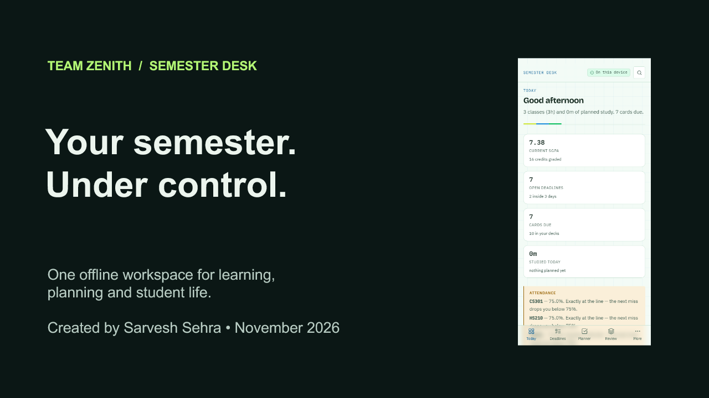

# Semester Desk · Team ZENITH

**[Download the PowerPoint](Zenith-Semester-Desk-Pitch.pptx)** · [Source notes](SOURCES.md) · [Full app guide](../USER_GUIDE.md)

Created by **Sarvesh Sehra**. The presentation uses a dark green and lime visual system, actual demo app screenshots, editable text/diagrams and a native editable data chart. Speaker notes contain demo guidance, sources and qualifications.

## Present it in 6–8 minutes

| Slides | Story | Demo cue |
| --- | --- | --- |
| 1–2 | Introduce Semester Desk and the fragmented student workflow. | Describe the problem as our hypothesis. The national enrolment number is a dated baseline, not our users. |
| 3–4 | Show one home and the source-to-plan workflow. | Bring a timetable or syllabus; inspect the preview before saving. |
| 5–6 | Connect notes, reviewed AI drafts, cards and practice. | Show an equation, edit a note and explain that AI is optional. |
| 7–10 | Make planning, academic progress, quality and student life visible. | Open Planner and show an overload warning rather than promising impossible study capacity. |
| 11–13 | Explain local ownership and measured release evidence. | Distinguish offline-cache payload from APK size. Physical Android acceptance remains a pilot check. |
| 14–15 | Teach the first session and propose the pilot. | End the walkthrough with an exported JSON backup. Pilot activity is proposed, not completed. |
| 16–17 | Introduce Team ZENITH and invite people to try it. | Keep the QR slide visible; each code and image link has a different destination. |

## Team ZENITH

Sarvesh Sehra · Aditya Rathi · Ayush Tyagi · Samiksha Jain · Cherry Agarwal · Bhavyata Singh

Names were provided by the team; no member roles are assumed. Project creator credit is **Sarvesh Sehra**.

## QR destinations

| Code | Destination |
| --- | --- |
| [Repository](../images/qr/repository.png) | [Source and guides](https://github.com/playxgaming/semester-desk-offline) |
| [Website](../images/qr/website.png) | [Open Semester Desk](https://playxgaming.github.io/semester-desk-offline/) |
| [Android](../images/qr/android.png) | [Latest signed APK](https://github.com/playxgaming/semester-desk-offline/releases/latest/download/semester-desk.apk) |

The website needs one completed offline asset setup before disconnecting. The APK is a signed sideload download, not a Play Store listing. Back up existing data before resetting, reinstalling or clearing browser storage.

## Editing and accessibility

Open the PPTX in PowerPoint or another compatible editor. Text, arrows and the payload chart remain editable. App screens and QR codes are embedded images with alt text. Maintain the QR white borders and verify scanning after changing their size. All chart values and limitations are documented in [SOURCES.md](SOURCES.md).
